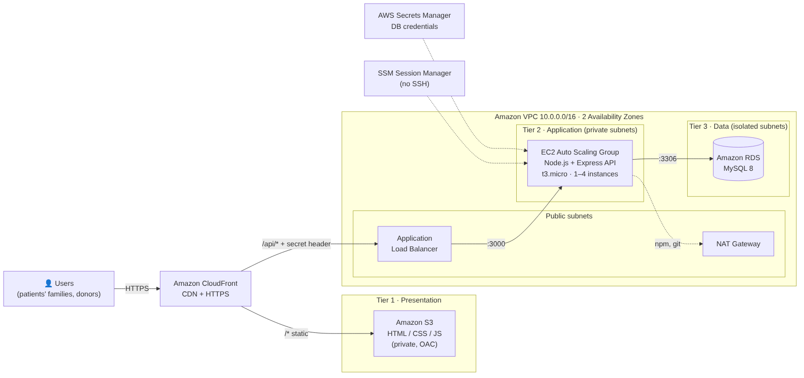

# 🩸 BloodLink: Find Compatible Blood Donors Fast

A three-tier web application on AWS that helps patients' families find **eligible, compatible blood donors in their city**, and lets hospitals or families post **urgent blood requests**.



---

## The problem

When someone needs blood urgently (an accident, surgery, dengue, thalassemia), families usually fall back on forwarded WhatsApp messages and phone calls. That breaks down in three ways:

1. **Outdated information.** Forwarded donor lists are rarely updated, so people call donors who moved away or stopped donating.
2. **Ineligible donors.** A donor who gave blood last month can't donate again yet (a whole-blood donor has to wait about 3 months), but lists don't track this.
3. **Compatibility confusion.** A family searching for "B+" often doesn't know that O+, O−, and B− donors can also help, so they miss donors who could save the patient.

## The solution

BloodLink keeps one live donor registry and answers one question well: *"Who in my city can give blood to this patient today?"*

| Feature | How it solves the problem |
|---|---|
| **Smart donor search** | Search by the patient's blood group and city. Results include every *compatible* group, with exact matches listed first. |
| **Eligibility rule** | Donors who donated in the last 90 days are hidden automatically, so nobody wastes a call. |
| **Urgent request board** | Families post the hospital, blood group, number of units, and deadline. Expired requests disappear on their own. |
| **Consent-based contact** | Donors explicitly agree to show their number. Searchers can call with one tap on mobile. |

---

## Architecture (3 tiers)

| Tier | AWS services | Why |
|---|---|---|
| **1 · Presentation** | **Amazon S3** (private bucket) + **Amazon CloudFront** | Static site served globally over HTTPS. The bucket is not public; only CloudFront can read it (Origin Access Control). |
| **2 · Application** | **Application Load Balancer** + **EC2 Auto Scaling Group** (Node.js/Express) in **private subnets** across 2 AZs | Stateless REST API that scales on CPU (target 60%). The ALB replaces unhealthy instances automatically. |
| **3 · Data** | **Amazon RDS for MySQL** in **isolated subnets** | Managed relational database with encryption at rest and automated backups. It has no internet route. |
| Supporting | **VPC**, **NAT Gateway**, **Secrets Manager**, **IAM**, **SSM Session Manager**, **CloudFormation** | Networking, secret handling, least-privilege access, SSH-free administration, and Infrastructure as Code. |

**Request flow:** the browser loads `https://<cloudfront>/`, and CloudFront serves the HTML/JS from S3. The JS calls `/api/...` on the same domain. CloudFront sees the `/api/*` path, adds a secret header, and forwards to the ALB. The ALB passes the request to a healthy EC2 instance, which queries RDS.

Because the frontend and API share the same CloudFront domain, there's **no CORS setup** and **no mixed-content problem**.

### Security highlights
- **Security-group chaining**: Internet → ALB :80 → EC2 :3000 → RDS :3306. Each tier accepts traffic only from the tier in front of it.
- **No public servers or database**: EC2 runs in private subnets, and RDS sits in subnets with no internet route.
- **ALB can't be bypassed**: the ALB returns `403` unless the request carries a secret header that only CloudFront adds.
- **No hard-coded passwords**: CloudFormation generates the DB password in Secrets Manager. EC2 reads it through its IAM role.
- **No SSH / port 22**: admin access goes through SSM Session Manager. Instances enforce IMDSv2.
- **XSS-safe frontend**: user data is rendered with `textContent`, never `innerHTML`. The API uses parameterized SQL.

---

## Project structure

```
bloodlink/
├── frontend/               # Tier 1: static site (S3 + CloudFront)
│   ├── index.html
│   ├── style.css
│   └── app.js
├── backend/                # Tier 2: Node.js REST API (EC2)
│   ├── src/
│   │   ├── server.js       # entry point
│   │   ├── app.js          # routes + validation
│   │   ├── db.js           # MySQL pool, auto-creates tables
│   │   └── compatibility.js# blood-group compatibility rules
│   ├── test/               # unit tests (node --test)
│   └── package.json
├── database/               # Tier 3: schema + local sample data
├── infrastructure/
│   └── bloodlink.yaml      # CloudFormation: the entire AWS stack
├── scripts/
│   ├── deploy.sh           # create/update stack + upload frontend
│   ├── update-backend.sh   # rolling deploy of new API code
│   └── destroy.sh          # delete everything
├── docs/architecture.png
└── docker-compose.yml      # run everything locally
```

---

## Run it locally (5 minutes)

You need [Docker Desktop](https://www.docker.com/products/docker-desktop/).

```bash
docker compose up
```

Open **http://localhost:3000**. The local database comes with sample donors in Pune, Mumbai, and Delhi. Try searching **B+ in Pune**: Priya (B+) shows as an exact match, Aarav (O−) and Sneha (O+) show as compatible, and Rohan (B+) is hidden because he donated 30 days ago.

Run the unit tests:

```bash
cd backend && npm test
```

---

## Deploy to AWS

### Prerequisites
1. An AWS account. **Set a billing alarm first** (Billing → Budgets → create a $5 budget).
2. The [AWS CLI v2](https://docs.aws.amazon.com/cli/latest/userguide/getting-started-install.html), configured with `aws configure` (region `ap-south-1`).
3. This project pushed to a **public** GitHub repo. EC2 instances `git clone` it when they boot.

### Deploy
```bash
chmod +x scripts/*.sh
./scripts/deploy.sh https://github.com/<your-username>/bloodlink.git
```
The first deploy takes about 15 minutes, mostly RDS and CloudFront. At the end, the script prints your live URL:
```
BloodLink is live at: https://d1234abcd.cloudfront.net
```
> Give the EC2 instance 2–3 minutes after the stack finishes to install Node and connect to the database. If `/api` returns 502/503 at first, wait and refresh.

### Update
- **Frontend change:** run `./scripts/deploy.sh <repo-url>` again (re-syncs S3 and clears the CloudFront cache).
- **Backend change:** `git push`, then run `./scripts/update-backend.sh`. This does a rolling instance refresh that boots new instances with the latest code.

### Tear down (important!)
```bash
./scripts/destroy.sh
```

### Cost
EC2 `t3.micro` and RDS `db.t3.micro` are covered by the AWS Free Tier/credits on eligible accounts. The **NAT Gateway and public IPv4 addresses are not free**: expect roughly a couple of US dollars per day while the stack is running. **Deploy, take your screenshots, record a demo, then run `destroy.sh`.** You can redeploy any time from the template.

---

## API reference

| Method | Path | Description |
|---|---|---|
| `GET` | `/api/health` | ALB health check |
| `POST` | `/api/donors` | Register a donor `{name, bloodGroup, city, phone, lastDonationDate?, consent: true}` |
| `GET` | `/api/donors/search?bloodGroup=B%2B&city=Pune` | Eligible, compatible donors (exact matches first) |
| `POST` | `/api/requests` | Post an urgent request `{patientName, bloodGroup, units, hospital, city, contactPhone, neededBy}` |
| `GET` | `/api/requests?city=Pune` | Open requests, most urgent first |

---

## For your CV

**BloodLink: Blood Donor Finder on AWS** · *Node.js, MySQL, AWS (VPC, EC2, ALB, Auto Scaling, RDS, S3, CloudFront, Secrets Manager, IAM, CloudFormation)*

- Designed and deployed a **three-tier web application on AWS** that matches patients with eligible, blood-group-compatible donors in their city, applying real donation-interval and red-cell compatibility rules.
- Wrote the **entire infrastructure as code with CloudFormation** (40+ resources): a custom VPC across 2 Availability Zones with public, private, and isolated subnets, a NAT Gateway, and route tables.
- Served the frontend from a **private S3 bucket through CloudFront (OAC)** and routed `/api/*` to an **Application Load Balancer**, which removed CORS and gave the app HTTPS end to end for users.
- Ran the Node.js REST API on an **EC2 Auto Scaling Group** with ELB health checks and **CPU target-tracking scaling**, with **zero-downtime rolling deploys** through instance refresh.
- Hardened security with **security-group chaining**, a **CloudFront-only ALB** (secret origin header), **Secrets Manager** for DB credentials, **SSM Session Manager instead of SSH**, IMDSv2, encrypted RDS storage, and parameterized SQL.

### Interview talking points
- *Why three tiers?* Each layer scales, fails, and is secured independently. The DB is never reachable from the internet.
- *Why CloudFront in front of the ALB?* One domain for static files and the API (no CORS), HTTPS at the edge, and edge caching for static assets.
- *What happens if an instance dies?* The ALB health check fails, traffic stops going to it, and the ASG launches a replacement in a healthy AZ.
- *Why is the health check "shallow"?* If it checked the DB, a short DB blip would mark *every* instance unhealthy, and the ASG would terminate them all.
- *What would you change for production?* See below.

---

## Future improvements
- **Custom domain + HTTPS to the origin**: Route 53 + ACM certificate on the ALB.
- **Authentication**: Amazon Cognito, so donors can log in, update their last donation date, and pause availability.
- **Notifications**: when an urgent request is posted, alert matching donors in that city via **Amazon SNS** (SMS) or **SES** (email) instead of exposing phone numbers.
- **Reliability**: RDS Multi-AZ, one NAT Gateway per AZ, and AWS WAF rate limiting on CloudFront.
- **CI/CD**: GitHub Actions running tests, then `deploy.sh` / `update-backend.sh` on every push to `main`.
- **Observability**: CloudWatch alarms on ALB 5xx errors, target health, and RDS CPU/storage.
